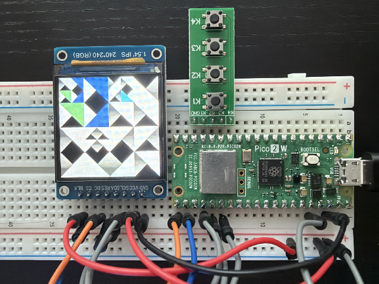
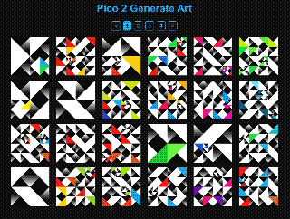

# Pico 2 W Random Art Bot

An autonomous generative-art pipeline built around a **Raspberry Pi Pico 2 W**.



The Pico renders 240×240 RGB565 artwork, displays it on a TFT, and sends the raw frame over Wi-Fi to a Python server. The server converts each frame to PNG, updates the web gallery data, and reports activity to an 8×8 status matrix. A separate Python bot combines new tiles into Bluesky posts on a randomized schedule.

**Generate → Receive → Save → Display → Post → Sleep → Repeat**

## System Overview

```text
┌─────────────────┐      POST /tile       ┌──────────────────┐
│ Pico 2 W + TFT  │ ────────────────────► │ Python server    │
│ 240×240 RGB565  │        Wi-Fi          │ RGB565 → PNG     │
└─────────────────┘                       └───────┬──────────┘
                                                │
                          ┌─────────────────────┼─────────────────────┐
                          │                     │                     │
                          ▼                     ▼                     ▼
                 public/images/        8×8 status matrix       public/images.json
                          │                                           │
                          ▼                                           ▼
                  Bluesky bot                                  Vite gallery
                          │
                          ▼
                      Bluesky
```

The components run independently:

- **Pico firmware** generates and uploads artwork.
- **Python server** receives frames, stores PNGs, serves image endpoints, and forwards status messages over serial.
- **Status firmware** animates the current workflow state on an 8×8 RGB matrix.
- **Bluesky bot** selects unposted artwork, creates a 2×2 composition, posts it, and records its history.
- **Vite gallery** reads the generated image manifest and displays the archive.

## Hardware

- [Raspberry Pi Pico 2 W](https://a.co/d/0bXTyKj8)
- 240×240 TFT using either a GC9A01 or ST7789 driver
- [Waveshare 8×8 RGB LED Matrix](https://www.amazon.com/dp/B0FP888B1W)
- A host computer running the Python services and gallery

Two art-generator sketches are included:

- `arduino/pico2_w_tile_generator.ino` uses the GC9A01 display driver.
- `arduino/pico2_w_deco_generator.ino` uses the ST7789 display driver.

The matrix controller is in `arduino/led_matrix_status.ino`.

## Prerequisites

- Python 3.9 or newer
- [uv](https://docs.astral.sh/uv/)
- Node.js and npm
- Arduino-compatible tooling and the libraries required by the selected firmware

Install the application dependencies from the project root:

```bash
uv sync
npm install
```

## Configuration

### Pico Firmware

In the selected generator sketch, set the Wi-Fi credentials and the host computer's LAN address:

```cpp
const char* ssid = "your-network";
const char* password = "your-password";
const char* serverIP = "192.168.1.100";
const int serverPort = 8080;
```

Flash the sketch to the Pico 2 W after confirming its display pins match your hardware.

### Status Matrix

Set `SERIAL_PORT` near the top of `server.py` to the serial device used by the status matrix. The standalone `status.py` animation test uses the same setting separately.

Examples:

```python
SERIAL_PORT = "/dev/cu.usbmodem1101"  # macOS
# SERIAL_PORT = "/dev/serial/by-id/..."  # Linux
```

The server opens this serial port during startup, so the matrix must be connected and available.

### Bluesky

Create `bot/.env` with a Bluesky handle and app password:

```dotenv
BLUESKY_HANDLE=yourbot.bsky.social
BLUESKY_APP_PASSWORD=xxxx-xxxx-xxxx-xxxx
```

The `.env` file is ignored by Git. Do not commit account credentials.

Posting behavior is configured in `bot/config.py`, including:

- `MIN_WAIT_MINUTES` and `MAX_WAIT_MINUTES`
- `BLUESKY_SERVICE`
- `MAX_IMAGE_SIZE`

The current posting interval is randomized between 420 and 580 minutes.

## Running Locally

Run each long-lived process in its own terminal.

### 1. Start the Image Server

```bash
uv run python server.py
```

The server listens on `0.0.0.0:8080`, stores images in `public/images/`, and updates `public/images.json`.

### 2. Start the Bluesky Bot

```bash
uv run python bot/bot.py
```

The bot logs in immediately, looks for unposted tiles, and writes activity to `bot/logs/bot.log`.

### 3. Start the Gallery

```bash
npm run dev
```

Vite normally serves the gallery at `http://localhost:5173`. Both Vite and the Python server read the same `public/` directory; no development proxy is required.

Create a production build with:

```bash
npm run build
```

The build output is written to `dist/`.

## Image Server

`server.py` accepts the following requests:

| Method | Path | Purpose |
| --- | --- | --- |
| `POST` | `/tile` | Receive one 240×240 RGB565 frame (`115,200` bytes) |
| `POST` | `/status` | Forward a plain-text status name to the matrix |
| `GET` | `/images.json` | Return the generated image manifest |
| `GET` | `/images/<filename>` | Return a stored PNG |

The manifest has this shape:

```json
{
  "images": [
    "tile_0092.png",
    "tile_0091.png"
  ]
}
```

Saved files use sequential names such as `tile_0000.png`. On startup, the server scans the existing files and continues after the highest number so it does not overwrite previous artwork.

## Bluesky Bot

For each post, the bot:

1. Finds tiles not listed in `bot/data/posted.json`.
2. Selects one tile, or has a 50% chance to select two when possible.
3. Builds a 480×480 composition from four 240×240 cells.
4. Uploads the composition with a randomized caption and descriptive alt text.
5. Records every source tile after a successful post.
6. Sleeps for a randomized interval while updating the status matrix every five minutes.

With one source tile, all four cells repeat it. With two source tiles, the four cells are randomized while guaranteeing both appear at least once.

```text
┌───────────┬───────────┐
│ 240 × 240 │ 240 × 240 │
├───────────┼───────────┤
│ 240 × 240 │ 240 × 240 │
└───────────┴───────────┘
          480 × 480
```

The generated upload is temporary; the original 240×240 PNGs remain unchanged.

## Gallery



The Vite + TypeScript + SCSS gallery currently provides:

- A responsive image grid
- 24 images per page
- Pagination
- A click-to-open image viewer
- Pixelated rendering and repeating modal backgrounds

Live gallery: [Pico 2 Tiles](https://pico2tiles.surge.sh/)

## Status Protocol

Serial packets use this structure:

```text
0xAA 0x55  TYPE  LENGTH  PAYLOAD...
```

Status packets use type `0x01`, a one-byte payload, and these values:

| State | Value |
| --- | --- |
| `IDLE` | `0x00` |
| `RECEIVED` | `0x01` |
| `SAVED` | `0x02` |
| `POSTING` | `0x03` |
| `POSTED` | `0x04` |
| `SLEEPING` | `0x05` |
| `ERROR` | `0x06` |
| `RESET` | `0x07` |

The matrix maps the workflow states onto the included idle, run, and twist animations. Animations loop until a new packet arrives. `RESET` restarts the current animation, which lets repeated `SLEEPING` updates visibly refresh the display.

Run the serial status cycle without the server or bot using:

```bash
uv run python status.py
```

## Project Structure

```text
pico2-genart-bot/
├── arduino/
│   ├── Animations.h
│   ├── led_matrix_status.ino
│   ├── pico2_w_deco_generator.ino
│   └── pico2_w_tile_generator.ino
├── bot/
│   ├── bot.py
│   ├── config.py
│   ├── data/posted.json
│   └── logs/bot.log
├── public/
│   ├── images/
│   └── images.json
├── src/
│   ├── gallery.ts
│   ├── main.ts
│   └── styles.scss
├── index.html
├── server.py
├── status.py
├── package.json
├── pyproject.toml
└── vite.config.ts
```

Generated images, logs, local environments, credentials, dependencies, and build output are excluded by `.gitignore`.

## Built With

Raspberry Pi Pico 2 W, Arduino/C++, RGB565, Python, Pillow, pySerial, AT Protocol, TypeScript, Vite, and SCSS.
